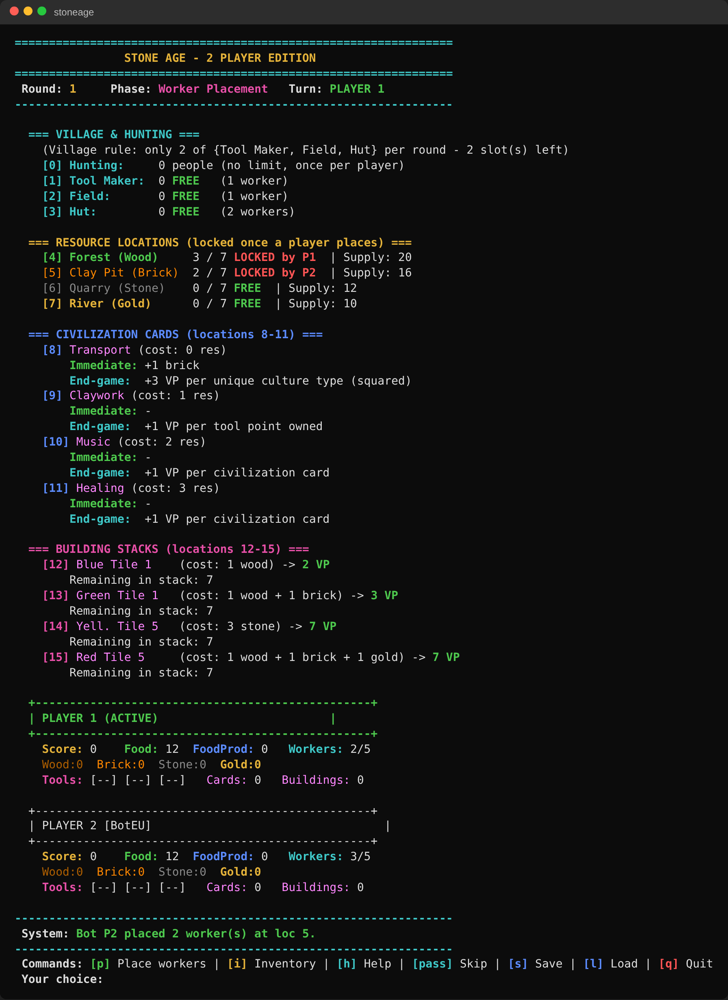

# Stone Age – CLI Board Game with AI Agents (C)

A terminal implementation of the board game **Stone Age** for 2 players, written in **C11**, with two heuristic **AI agents** that can play against humans or against each other.

Built as an individual university project at **Politehnica University of Timișoara** (Faculty of Automation and Computers, 1st year). Every student implemented the same game independently; in the final phase, each student's AI agent was matched in a **duel** against the agent built by a classmate.

   
   
---

## Features

- **Full game loop**: worker placement, resource gathering with dice, tools, villages, civilization cards, buildings, feeding phase and end-game detection
- **Rule validation**: location limits, the "2 of 3 village slots" rule, resource locations locked per round, feeding penalties
- **Complete final scoring**: buildings, civilization cards (flat, per-tool, per-hut, per-card, per-farm, multiplier), leftover resources, plus a tiebreaker
- **5 game modes**: Human vs Human, Human vs BotEU, Human vs BotColeg, BotEU vs BotColeg, BotColeg vs BotColeg
- **Colored terminal UI** (ANSI) showing the board, cards, buildings and player stats, with an in-game help screen
- **Save / Load** of the full game state (binary file)
- **Game log** with timestamps for every action (`game_log.txt`)
- **29 unit tests** that run automatically at startup

---

## AI Agents

### BotEU – adaptive agent (my agent)
- **Observes the opponent** each round: resources, tools, people, food production, card types
- From round 3 on, **chooses one of three strategies** based on what it observed:
  - **Aggro Builder**: buys buildings whenever affordable and invests in tools and resources
  - **Card Rusher**: prioritizes civilization cards
  - **Hoarder**: grows population and food production early, then buys long-term scoring cards
- **Sabotage mode**: when the opponent becomes dangerous (can afford expensive buildings, gains resources quickly, or has high food production or many cards), the bot spends 1–2 rounds blocking the locations the opponent needs. A recovery round follows.
- **Strategy switching**: if the opponent keeps blocking it, the bot changes strategy
- **Smart tool usage**: uses the tool that just reaches the next yield threshold, with minimal waste

### BotColeg – opponent agent for the duel
A rule-based agent with three selectable personalities (**Resource Rush**, **Card Sniper**, **Engine Builder**). The Engine Builder personality adapts its priorities to the phase of the game (early, mid, late).

The heuristic analysis behind the agents (expected yields, value of each location, target score breakdown) is documented in [`ANALYSIS.md`](ANALYSIS.md).

---

## Build & Run

**Requirements:** a C compiler (GCC / MinGW / Clang) and CMake ≥ 3.20

```bash
# configure
cmake -B build

# build
cmake --build build

# run
./build/stoneage          # Linux / macOS
build\stoneage.exe        # Windows
```

Without CMake:

```bash
gcc -std=c11 -o stoneage main.c game_logic.c persistence.c ui.c tests.c scoring.c bot_eu.c bot_glue.c bot_coleg.c
./stoneage
```

> On Windows, use **Windows Terminal** or the CLion terminal so the ANSI colors are displayed correctly.

---

## How to Play

On startup the unit tests run, and then you choose the game mode.

| Command | Action |
|---------|--------|
| `p`     | Place workers (asks for location ID and number of workers) |
| `i`     | Show the inventory of all players |
| `h`     | Help screen with all the rules |
| `pass`  | Skip turn |
| `s` / `l` | Save / Load the game |
| `q`     | Quit |

### Board locations

| ID | Location | Rule |
|----|----------|------|
| 0 | Hunting | Any number of workers; dice sum / 2 = food |
| 1 | Tool Maker | 1 worker; +1 tool immediately (max value 4) |
| 2 | Field | 1 worker; +1 food production |
| 3 | Hut | Exactly 2 workers; +1 person |
| 4–7 | Forest / Clay Pit / Quarry / River | Up to 7 workers; dice sum / 3, 4, 5, 6 |
| 8–11 | Civilization cards | 1 worker; cost = 0–3 resources |
| 12–15 | Building stacks | 1 worker; pay resources and get victory points |

Only 2 of the 3 village locations (1–3) can be used each round. The game ends when a building stack is empty or fewer than 4 civilization cards are left.

---

## Project Structure

```
├── main.c            # game loop, game mode selection, round resolution
├── game_types.h      # Player, Board, constants, location IDs
├── cards.h           # civilization card and building templates
├── game_logic.c/.h   # placement, validation, dice, evaluation, feeding, game over
├── scoring.c/.h      # final scoring and tiebreaker
├── ui.c/.h           # terminal rendering and help screen
├── persistence.c/.h  # save/load and game log
├── tests.c/.h        # unit tests
├── bot_eu.c/.h       # BotEU – adaptive AI agent
├── bot_coleg.c/.h    # BotColeg – opponent agent used for the duel
├── bot_glue.c/.h     # connects the bots to the game engine
├── ANALYSIS.md       # heuristic analysis (Milestone 5)
└── CMakeLists.txt
```

---

## Development Milestones

1. Data structures (`Board`, `Player`, `CivCard`, `BuildingCard`)
2. Worker placement and rule validation
3. Location and resource evaluation
4. Save/Load, game log, end-game detection
5. Final scoring and heuristic analysis
6. AI agent and duel against a classmate's agent

---

## Tech

`C11` · `CMake` · `ANSI terminal UI` · `binary file I/O` · `unit testing` · `heuristic AI`
